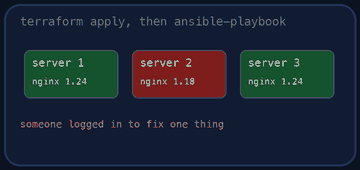
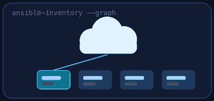
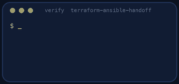
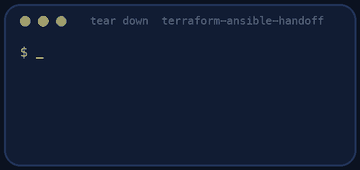

<p align="center"></p>

| | |
|-|-|
| **Time** | 105-120 min |
| **Cost** | free tier, a few cents |
| **You need** | An AWS administrator user, the AWS CLI v2, Terraform 1.10 or newer, Ansible (ansible-core 2.15 or newer, with the amazon.aws collection and boto3), git, curl and a terminal (Linux, macOS, or Windows with WSL) |

## How this lab works

1. **Fork** this repository to your own GitHub account (button at the top right).
2. Clone **your fork** in your Ubuntu environment (WSL on Windows, your OrbStack machine on Mac).
3. Read the lab below (the same text is in [`LAB.md`](LAB.md)) and follow the mission.
4. Answer the questions in [`SUBMISSION.md`](SUBMISSION.md). Where a question asks for output, paste it in a code block. No screenshots needed.
5. Commit and push. Open the **Actions** tab of your fork (click *I understand my workflows, go ahead and enable them* the first time). The **Lab check** shows what is still missing.
6. When the check is green, **submit the URL of your fork** in the course platform.

> [!NOTE]
> The check only looks at your answers and any files the lab asks you to commit. Your instructor reads your work and may ask you to explain any line.

<p align="center"></p>

## 🎬 The situation

<p align="center"></p>

Pollie's web site needs two servers: a web server for the public and a small app server that only the web server may talk to. Last time, the servers were built with Terraform by one engineer and configured with Ansible by another, and the glue between them was a text file with two IP addresses that somebody pasted by hand. Then a server was replaced, the IP changed, nobody updated the file, and Nginx spent a day proxying to a machine that no longer existed.

Terraform is good at *making things exist*. Ansible is good at *making things correct*. Neither knows about the other. You will build the handoff so that no human carries an IP address from one to the other: **Terraform tags the servers, Ansible finds them by tag.** Then you will prove it by destroying a server and getting the whole thing back with two commands.

> [!IMPORTANT]
> **Your mission**
> - Write the Terraform for the key pair, the two firewalls and **both servers from one resource** (the network is provided)
> - Write a **dynamic inventory** that finds the servers in AWS by tag, with no IP address in any file
> - Write one playbook that configures both: a baseline, a tiny status service on the app server, Nginx on the web server
> - Make Nginx learn the app server's private IP **from the inventory**, not from you
> - Replace the app server and see everything heal without editing a file

**Time:** 105-120 min | **Cost:** free tier, a few cents | **You need:** an AWS administrator user, the AWS CLI v2, Terraform 1.10 or newer, Ansible (`ansible-core` 2.15 or newer) with the `amazon.aws` collection and `boto3`, git, curl and a terminal. On Windows use WSL. Everything uses `us-east-1`.

<p align="center"></p>

## Part 0 - Prepare your machine

Fork this repository, clone your fork, and run:

```bash
./setup.sh
```

It checks your tools, clones Pollie's web app into `pollie/`, creates an SSH key in `keys/` and writes your public IP into `terraform/terraform.tfvars` (not committed). **It creates nothing in AWS.**

If it complains about `boto3`: the dynamic inventory plugin runs inside Ansible's own Python, and that Python needs `boto3`. The message tells you the exact command for your installation.

Now read what is provided:

1. `terraform/main.tf` is the work of the "network team": a VPC, an internet gateway, one public subnet and the Ubuntu image to use. Read it. Do not change it.
2. `files/pollie_status.py` and `files/pollie-status.service` are a very small service (a Python script and its systemd unit) that will run on the app server and answer on port 8000.

> [!NOTE]
> **Think** The app server will have a public IP too (it needs one to reach the internet for `apt` and for you to reach it by SSH). Yet nobody on the internet may reach port 8000 on it. Which resource decides that? Hold that thought for Part 1.

<p align="center"></p>

## Part 1 - Terraform: the servers

<p align="center"></p>

Open `terraform/servers.tf`. It is a list of TODOs. Write:

1. The **key pair**, from the public key `setup.sh` created.
2. **Two security groups**. SSH from your address only (`var.my_ip_cidr`), port 80 from everywhere on the web server, and port 8000 on the app server **only from the web server's security group**: a rule that points at a group, not at an address.
3. **One** `aws_instance` resource that builds *both* servers (`for_each` over a small map). Ubuntu from the provided image parameter, `t3.micro`, IMDSv2 required, tags `Name = pollie-<role>` and `Role = <role>`.
4. Two outputs: `web_url` and `ssh_hint`.

Run it:

```bash
cd terraform
terraform init
terraform apply
```

> [!NOTE]
> **Think** You tagged the servers `Role`. Terraform will never read that tag again. Who will? Write your guess for question 1.

> [!NOTE]
> **Predict** In ten minutes you will replace the app server. It will get a new instance ID, a new public IP and a new private IP. Which of those will still be right in the security group rule? Answer before you check.

<p align="center"></p>

## Part 2 - The inventory that has no addresses

Ansible needs a list of machines. A static `inventory.ini` would hold two IPs that go stale. Instead use the **`amazon.aws.aws_ec2` inventory plugin**: it asks AWS "which instances exist?" every time you run Ansible.

Fill in `inventory.aws_ec2.yml` and `ansible.cfg` following the comments. Then look at what Ansible sees:

```bash
ansible-inventory --graph
ansible-inventory --host pollie-web
```

You want the groups `role_web` and `role_app`, built from the `Role` tag, and the host names from the `Name` tag. Read the variables of one host: find the one that holds its **private** IP address. You will need it in Part 4.

```bash
ansible all -m ping
```

Servers take about a minute to accept SSH after they start. If `ping` says `UNREACHABLE`, wait and try again; if it still fails after three minutes, check the security group, the key and `ansible.cfg`.

> [!NOTE]
> **Think** The plugin filters on `tag:lab`. What would happen if this account also had your colleague's servers from another exercise, and the filter was missing?

<p align="center"></p>

## Part 3 - The playbook

Write `site.yml` as described in its comments: one play for every server (the baseline), one for `role_app`, one for `role_web`. Rules: **modules only** (no `shell`, `command`, `raw`, `script`) and **running it twice must change nothing**.

```bash
ansible-playbook site.yml
ansible-playbook site.yml
```

Read both recaps. The second one must say `changed=0` for both servers.

> [!TIP]
> **Stuck?** The systemd unit file is new, so `systemd` must be told to reload before it can start the service: put `daemon_reload` in a handler, and look up `meta: flush_handlers` to run it *before* the task that starts the service. Nginx answers `502` after you configured the proxy: the app service is not running, or port 8000 is closed to the web server's group. Nginx refuses the config: run `sudo nginx -t` on the server and read the line number.

<p align="center"></p>

## Part 4 - The value that crosses the boundary

Two templates are still empty:

- `templates/status.json.j2` writes the app server's **own name and private IP** into a small JSON document that the status service serves.
- `templates/pollie.conf.j2` is Nginx's site: it serves Pollie's files and sends `/api/` to the app server's port 8000.

The second one needs the private IP of a **different** host from the one it is being rendered for. In Ansible, every host's variables are reachable through `hostvars`, and `groups` lists which hosts are in which group. Build the `proxy_pass` line from those. No IP address may be typed anywhere.

```bash
ansible-playbook site.yml
curl -i http://<web ip>/
curl http://<web ip>/api/status
```

The first shows Pollie's page and your `X-Served-By` header. The second travels: your laptop, Nginx on the web server, the private network, the Python service on the app server. The JSON that comes back must contain the app server's private IP.

> [!NOTE]
> **Think** Try `curl http://<app public ip>:8000/status` from your laptop. What happens, and which of your Terraform lines is responsible?

<p align="center"></p>

## Part 5 - Destroy a server. Heal it.

This is the whole point of the lab. Replace the app server only:

```bash
cd terraform
terraform apply -replace='aws_instance.server["app"]'
cd ..
ansible-inventory --graph
```

The new server has a new IP and no software. Wait for SSH, then:

```bash
ansible-playbook site.yml
curl http://<web ip>/api/status
```

Look at the recap: which server had `changed=10` and which only `changed=2`? Why did the web server change at all, if you did not touch it?

Did you edit a single file between the replacement and the working site? If the answer is no, you have built what this lab is about.

> [!NOTE]
> **Predict** You add a *third* server by changing one number in Terraform. What would you have to change in Ansible for it to be configured too? What if it has a new `Role` tag?

<p align="center"></p>

## Part 6 - Prove it

<p align="center"></p>

```bash
./verify.sh
```

It checks your code, reads the **real servers and firewalls** in AWS, runs `terraform plan` (it must find nothing to change), asks the inventory what it sees, **runs your playbook twice** (the second run must change nothing) and uses the site, including the proof that the private IP in the JSON is the real one and that port 8000 is closed to the internet. It takes a few minutes. Fix what is red and run it again until it ends with **ALL CHECKS PASSED**.

> [!TIP]
> **Stuck?** `The amazon.aws.aws_ec2 plugin ... boto3`: install it in Ansible's Python (see Part 0). Inventory is empty: the filter has the wrong tag, or the servers are not `running` yet. `Permission denied (publickey)`: `ansible.cfg` has the wrong key path or user (`ubuntu` on this image). `UNREACHABLE` after your IP changed: update `terraform/terraform.tfvars` and run `terraform apply`; the SSH rule is a /32 on purpose.

<p align="center"></p>

## Level up (optional)

- Add `tags.Role` to the group names in a second `keyed_groups` entry for the instance type, then run the baseline only on `t3_micro` hosts.
- Write the inventory so that it uses `private_ip_address` for hosts that have no public IP, then add a bastion in your head: what would change in Terraform and in `ansible.cfg`?
- Run `ansible-playbook site.yml --check --diff` after editing `/etc/nginx/conf.d/pollie.conf` by hand on the web server. Read what Ansible would put back.
- Put `terraform apply && ansible-playbook site.yml` in a `Makefile` target. What is missing between those two commands for a real pipeline? (Hint: the first minute of a new server.)

<!-- teardown:start (generated by labs.py, do not edit) -->
## Tear down (mandatory)

<p align="center"></p>

Resources left behind cost money, keep doors open and pollute the next lab. Removing what you created is part of the job, so it is part of the submission: **you must prove it is gone**.

Do this **last**, after you have pasted your `verify` output into `SUBMISSION.md` (once you tear down, the lab can no longer be verified).

1. Run `./teardown.sh` (it runs `terraform destroy`, then removes the generated SSH key and the cloned Pollie source). Everything is tagged `lab=terraform-ansible-handoff`.

Then run the proof:

```bash
./verify-teardown.sh
```

It prints a list of checks and must end with **TEARDOWN VERIFIED**. If it reports leftovers, remove them and run it again. Paste the full output in your submission.
<!-- teardown:end -->

<!-- submission:start (generated by labs.py, do not edit) -->
## 📬 Submission

Answer the questions in `SUBMISSION.md` in **your fork** (paste output in code blocks where asked), push, then submit the **URL of your fork**.

**Files to commit**

- `terraform/servers.tf`: key pair, security groups, the two servers and the outputs (the network in `main.tf` is provided)
- `inventory.aws_ec2.yml`: the dynamic inventory
- `ansible.cfg`, `site.yml` and the templates in `templates/`

**Questions to answer**

1. Paste `terraform output` and `ansible-inventory --graph`. Nobody typed an IP address into the inventory: where does Ansible get its list of servers, and which tags make the groups?
2. Show the security group rules of the two servers. Why is port 8000 of the app server open to the web server's security group and not to a CIDR? What happens to that rule when the web server is replaced?
3. Paste the `PLAY RECAP` of your first run and of the second. Why must the second say `changed=0`? Which of your tasks would have broken that?
4. The Nginx template needs the private IP of the app server. Paste the line and say where that value comes from (Terraform, AWS, Ansible?) and what happens to it when the app server is rebuilt.
5. Replace the app server (`terraform apply -replace=...`), run the playbook again and `curl` the web server's `/api/status`. Paste both. What did you have to edit by hand? If the answer is "nothing", which two design choices made that true?
6. Your SSH rule allows one /32. You come back tomorrow from another network. What fails first, Terraform or Ansible, and how do you fix it without opening SSH to the world?
7. Paste the output of `./verify.sh`. It must end with **ALL CHECKS PASSED**.
8. **Tear down.** Paste the output of `./verify-teardown.sh`. It must end with **TEARDOWN VERIFIED**.
<!-- submission:end -->
